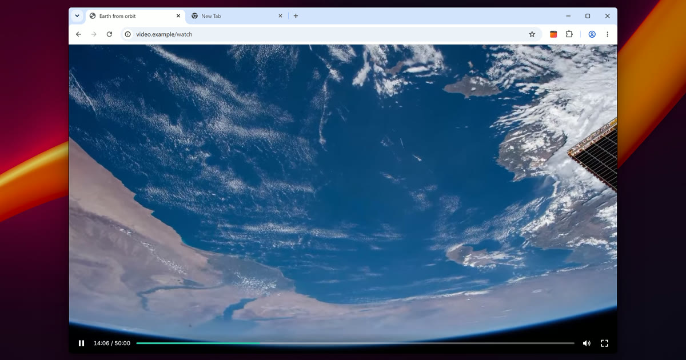
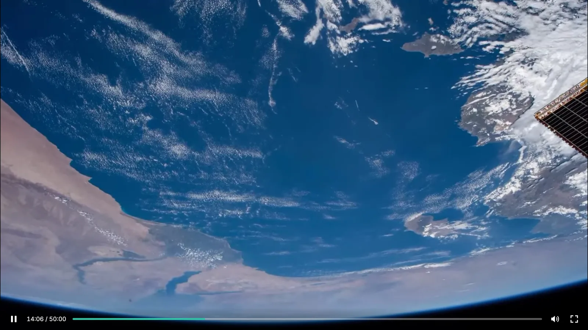
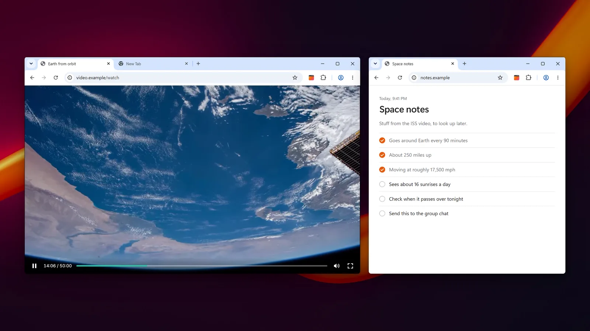
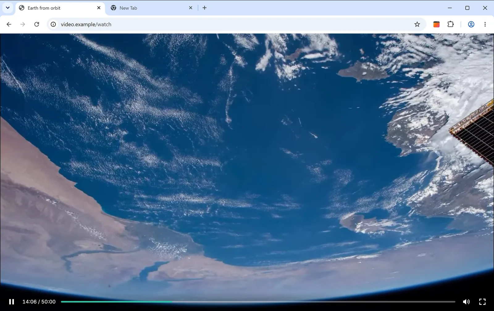
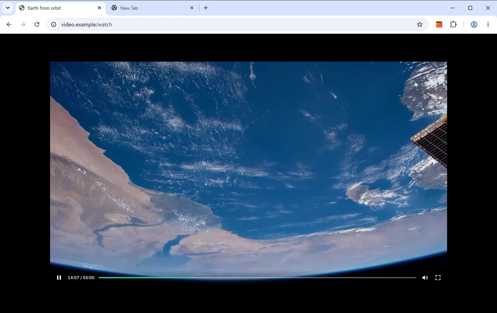
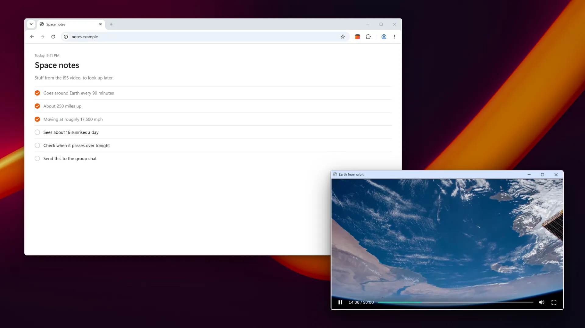

<p align="center">
  
</p>

<h1 align="center">Full Window, Not Screen<br /><sub>Video Sizer</sub></h1>

<p align="center">
  <strong>Hit fullscreen on a video and it fills the browser tab instead of your whole screen.</strong><br />
  For Chrome and Microsoft Edge · Collects nothing
</p>

<p align="center">
  <a href="https://avorforge.com/full-window/">Website</a> ·
  <a href="https://avorforge.com/full-window/privacy">Privacy policy</a> ·
  Coming soon to the Chrome Web Store and Microsoft Edge Add-ons
</p>

<p align="center">
  
</p>

## It fills the tab, not the screen.

Normally, fullscreen takes over your whole monitor. **With Full Window on, the video fills the browser tab and
everything else stays put.** You can still check another window, keep an eye on chat, or get some work done.

| Normal fullscreen | With Full Window |
| :---------------: | :--------------: |
|  |  |
| The video covers your whole screen. | The video fills the tab. Everything else stays put. |

## Pick the size.

Set it once for every site, or give a site its own size. **It's all in the toolbar button.**

| Fill tab | Custom size | Pop out |
| :------: | :---------: | :-----: |
|  |  |  |
| The video fills the whole tab. | Pick a width and height, in pixels or percent, and where it sits. | Moves the video into its own small window you can put anywhere. Press Esc and it goes back. |

## Good to know.

- **The player still works.** The site thinks it's in fullscreen, so its own controls keep working: play, pause,
  seek, volume, captions and quality. Picture-in-picture only gives you the browser's basic controls.
- **Every site, or just this one.** Click the toolbar icon to change it for every site, or just the one you're on.
- **Press Esc to get out.**
- **Need real fullscreen?** <kbd>Alt</kbd>+<kbd>Shift</kbd>+<kbd>F</kbd> switches between the tab and your whole
  screen. You can change the key in your browser's shortcut settings.
- **On or off at a glance.** The toolbar icon shows whether it's on for the site you're on.

## Privacy

**It doesn't collect anything.** No tracking, no account, and it never connects to the internet. Your settings
stay in your browser. If you use browser sync, they sync like your other settings.

When you install it, the browser warns that it can "read and change all your data on all websites." That sounds
scary, so here's why: **it has to catch the fullscreen button on any site, including videos embedded from other
sites. It doesn't read or send anything.** The whole extension is in this repository, so you can check.

[Read the privacy policy](https://avorforge.com/full-window/privacy)

## Questions

**How do I get normal fullscreen back?**
Press <kbd>Alt</kbd>+<kbd>Shift</kbd>+<kbd>F</kbd>. It switches between fullscreen in the tab and your whole
screen. You can also turn it off for a site from the toolbar icon.

**Can I turn it off for one site?**
Yes. Go to the site, click the toolbar icon, and flip the switch.

**Is there a Firefox or Safari version?**
Not right now. It's only for Chrome and Microsoft Edge.

**A site doesn't work. Now what?**
Email [inquiries@avorforge.com](mailto:inquiries@avorforge.com) with the link and we'll take a look.

---

## For developers

A Chromium Manifest V3 extension in TypeScript. When a page asks for fullscreen, a script in the page's own
world answers the Fullscreen API itself: the browser never enters real fullscreen, the element is pinned to the
chosen rectangle, and the page gets the same events and `:fullscreen` styling it would in real fullscreen.
Players embedded in cross-origin frames work too. The design, its limits and the test plan are in
[docs/ARCHITECTURE.md](docs/ARCHITECTURE.md).

It asks for one permission, `storage`, plus content scripts on all sites. There's no remote code, telemetry or
network request.

### Build and run

You need Node.js 20 or newer (`.nvmrc` pins the version used here) and Chrome or Edge 111 or newer.

```sh
npm ci            # install exactly what package-lock.json pins
npm run build     # build an unpacked extension into build/
```

To load it, open `chrome://extensions` (or `edge://extensions`), turn on **Developer mode**, click **Load
unpacked** and pick the `build/` folder. After a rebuild, reload the extension's card and then the pages you test
on, since content scripts are injected at page load.

| Script | What it does |
| ------ | ------------ |
| `npm run build` | Bundle every entry point with esbuild into `build/`, copy the manifest, pages, font and icons, and validate the result |
| `npm run build:dev` | The same, unminified, with inline source maps |
| `npm run validate` | Type-check (strict `tsc`) and unit tests (vitest): the gate that needs no browser |
| `npm run test:e2e` | End-to-end tests: the built extension in Chromium, driven by Playwright |
| `npm run test:all` | `validate`, then `test:e2e` |
| `npm run package` | Build, then zip `build/` into `dist/full-window-not-screen-video-sizer-<version>.zip` for the stores |
| `npm run icons` | Re-render the icon PNGs in `src/icons/` from their SVG sources |
| `npm run store:assets` | Render the Edge store logo from the icon's SVG |

### Tests

The unit tests cover settings and migration, geometry, the message protocol, the Fullscreen API layer, the
pop-out window and the UI pages. The end-to-end tests load the production build into Chromium and drive local
fixture pages on two origins, so embeds are really cross-origin: every size, Esc, frames, the pop-out window, the
popup and options pages, and the shortcut. Nothing touches the network.

```sh
npx playwright install chromium            # once
npm run test:e2e                           # builds first, then runs tests/e2e/*.spec.ts
npm run test:e2e -- tests/e2e/frames.spec.ts
```

When a test fails, `test-results/<test>/` keeps a screenshot of each page, a Playwright trace and each frame's
log. Run `validate` and `test:e2e` one after the other, not side by side: both rebuild `build/`.

### Layout

```
manifest.json         source manifest (the build adds the name and version)
src/background/       service worker: settings migration, the shortcut, the pop-out window
src/content/          the Fullscreen API layer in the page's world, and the extension-side script that
                      relays settings, frames, Esc and the pop-out bar
src/shared/           settings, messages, geometry, and brand.ts (name, description, credit)
src/ui/               the toolbar popup, the settings page and the pop-out placeholder tab
src/icons/            the icons the build copies; svg/ holds their sources
scripts/              build, package, manifest validation, icon rendering
store/                store listing, privacy policy, the product page (site/) and the store images
tests/                unit tests; tests/e2e/ holds the Playwright specs, harness and fixture pages
docs/ARCHITECTURE.md  how it works and why
```

The product name, description and credit live in `src/shared/brand.ts`, and the build writes them into the
manifest and the pages. The store images and the product page in `store/` are finished design files, committed
as they are.

## Credits

Made by [Avor Forge LLC](https://avorforge.com/). Support: [inquiries@avorforge.com](mailto:inquiries@avorforge.com).

The extension's pages use [Inter](https://github.com/rsms/inter) 4.1 by The Inter Project Authors, under the
[SIL Open Font License 1.1](src/ui/fonts/OFL.txt). A Latin subset ships with the extension and loads from its own
files.

Video in the pictures: "Earth from Space in 4K – Expedition 65 Edition," courtesy of NASA. NASA doesn't endorse
this extension. Wallpaper photo by Steve A Johnson on Pexels. Chrome is a trademark of Google LLC. Microsoft Edge
and Windows are trademarks of Microsoft Corporation. This extension isn't made or endorsed by Google or Microsoft.
